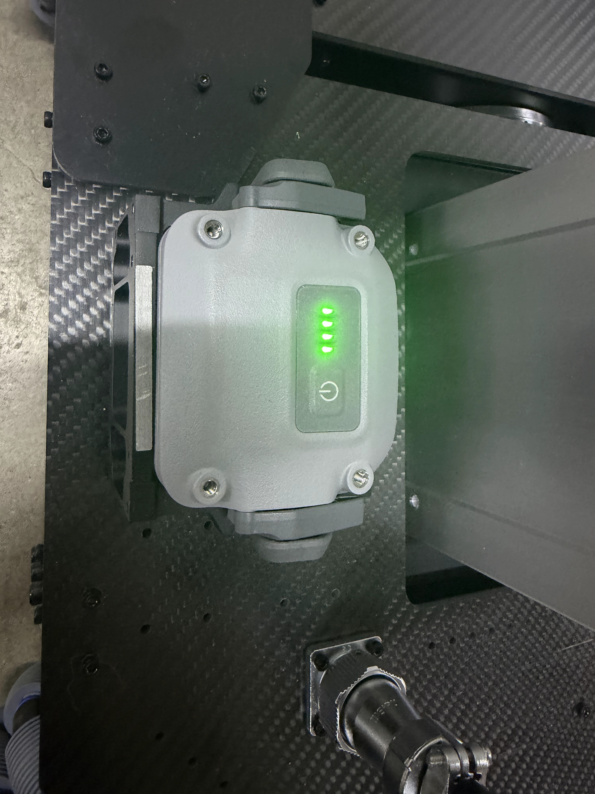
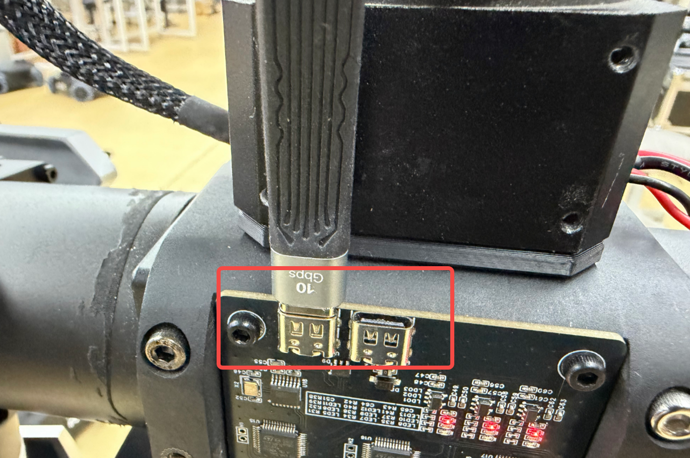
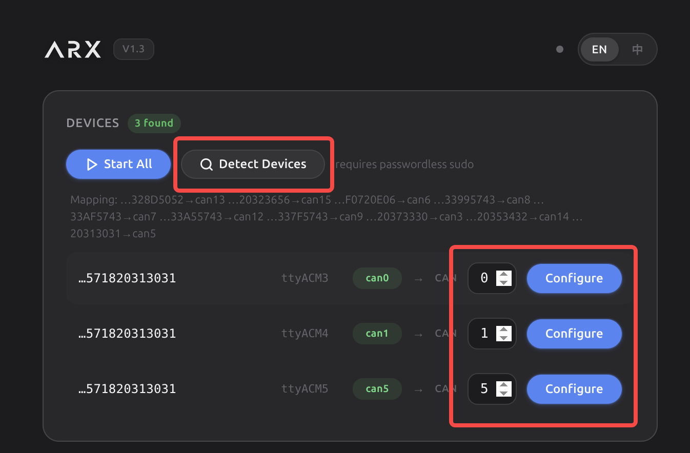

# X7 Python SDK V1.5

> [!WARNING]
> 使用机器人时，务必确保安装稳定，以基座为轴心一米半径内保持空旷，当心碰撞易碎物品及造成人员损伤。**出现紧急情况请先关闭电源。**

**运行环境**：仅支持 Ubuntu 24.04，Python > 3.8

## 目录

- [1. 硬件设备连接](#1-硬件设备连接)
- [2. 环境配置](#2-环境配置)
- [3. CAN 设备配置](#3-can-设备配置)
- [4. 运行示例](#4-运行示例)
- [5. 机械臂 SDK](#5-机械臂-sdk)
- [6. 机身 SDK](#6-机身-sdk)

---

## 1. 硬件设备连接

### 1.1 电源连接

本设备采用双电池组，支持热插拔，可快速更换。

<p align="center">
  
</p>

<p align="center">
  
</p>

<p align="center">
  
</p>

> [!IMPORTANT]
> - 启动前请先将**急停开关**旋开。
> - 出现紧急情况时，用脚或工具按下急停开关。

### 1.2 CAN 设备连接

通过 USB 线及延长线连接至电脑 USB 口。两个 Type-C 口功能相同，另一个为备用。

<p align="center">
  
</p>

---

## 2. 环境配置

在 `X7_sdk` 根目录下执行：

```bash
./01_global_nopasswd_sudo.sh.x
./install_deps.sh
```

---

## 3. CAN 设备配置

双击启动 `ARX_CAN_doctor`：

1. 点击 **Detect Devices** 检测设备；
2. 将各设备编号依次修改为 `0`、`1`、`5`，并分别点击 **Configure**；
3. 点击 **Start All** 启动。

<p align="center">
  
</p>

---

## 4. 运行示例

### 4.1 移动平台（底盘 + 升降 + 头部）

在 `X7_sdk/LIFT-SDK` 目录下：

```bash
python3 demo_sdk.py
```

### 4.2 机械臂

在 `X7_sdk/x7s/py/ARX_x7_python` 目录下：

```bash
./build.sh
source setup.sh

# 单臂
python3 test_single_arm.py

# 双臂
python3 test_dual_arm.py
```

---

## 5. 机械臂 SDK

### 5.1 控制接口

| 功能 | 接口 |
| --- | --- |
| 夹爪控制 | `set_gripper_pos()` |
| 末端姿态控制 | `set_ee_pose_xyzrpy(xyzrpy)` |
| 关节位置控制 | `set_joint_positions(positions=positions)` |

### 5.2 状态反馈

包括关节反馈（位置、速度、扭矩）和末端位姿反馈。

| 功能 | 接口 | 说明 |
| --- | --- | --- |
| 关节位置反馈 | `get_joint_positions()` | |
| 关节速度反馈 | `get_joint_velocities()` | |
| 关节扭矩反馈 | `get_joint_currents()` | |
| 末端位姿反馈 | `get_ee_pose_xyzrpy()` | 欧拉角形式 |

---

## 6. 机身 SDK

底盘轮子 ID 如下（箭头为车头方向）：

<p align="center">
  
</p>

### 6.1 高度控制

```python
robot.set_height(set_lift_height)
```

### 6.2 底盘整体速度控制

模式设置为 `1`，参数依次为 `x, y, z, mode`：

```python
robot.set_chassis_cmd(x, y, z, 1)
```

### 6.3 轮速控制

模式设置为 `3`，再分别设置四个轮子的速度：

```python
robot.set_chassis_cmd(0, 0, 0, 3)
robot.set_wheel_vel(v1, v2, v3, v4)
```

### 6.4 头部控制

角度单位为 rad（仅 X7 机型有效，LIFT 机型为空操作）：

```python
robot.set_head_yaw(0.2)
robot.set_head_pitch(-0.2)
```

### 6.5 状态获取

```python
print(f"当前高度: {get_chassis_height}")
print(f"轮速: {get_wheel_vel}")
print(f"头部角度: {get_head_pos}")
```

